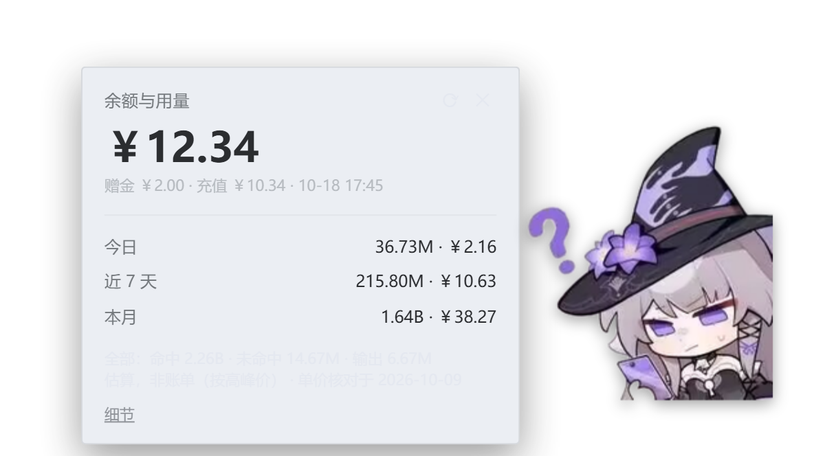
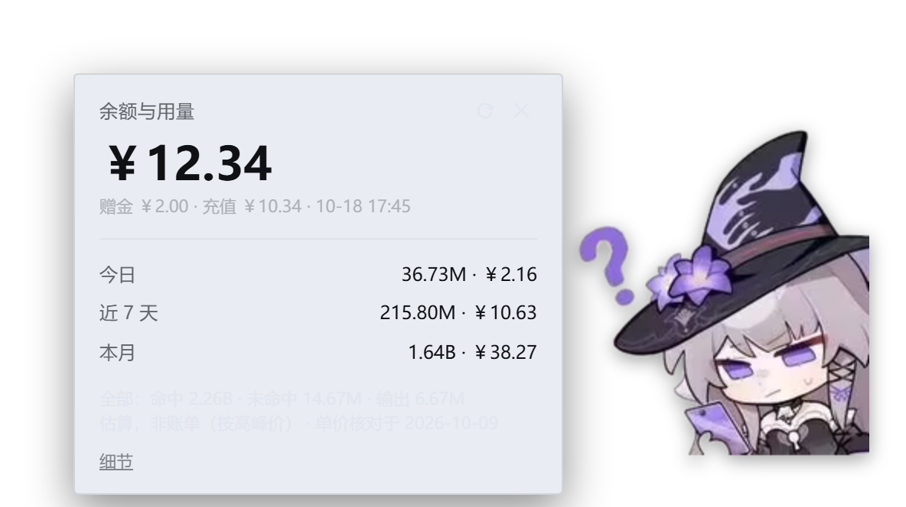

# dsh-balance-card

给 DeepSeek Harness 的一张**「余额与用量」浮层卡片**：图片按钮可拖动，**点一下从图片左侧滑出卡片、
再点一下缩回**（带点击回弹动画），显示官方账户余额（含赠金/充值拆分）与本地会话的 token 用量
（今日 / 近 7 天 / 本月）和人民币估算花费。

- 余额：先走官方 `GET https://api.deepseek.com/user/balance`（密钥由 DSH 的凭据服务**现读**）；
  API key 未配置或被拒时，**回退到 DSH 账号登录态**
  （`platform.deepseek.com/api/v0/users/get_user_summary`，令牌同样由凭据服务现读，
  请求头 `x-dsh-auth-token`），令牌永不落盘、永不出宿主。
- 用量：直接折 DSH 原生会话日志（`session.v4.jsonl.zstd`），三段计价（缓存命中 / 未命中 / 输出），
  并按官方规则**逐条事件判定峰谷价**（北京时间工作日 9:00-12:00、14:00-18:00 为高峰，周末与法定节假日全天
  为空闲，空闲价是高峰价一半），**只统计当前工作区**。
- 形态：自己往 `document.body` 插一层浮层，**不进任何 slot** —— 官方 0.2.0 删过一个第三方插件在用的
  slot，这是实测教训。
- 卡片在图片**左侧**：图片与卡片都常驻，图片永远在最上层；开合是 `transform`/`opacity` 过渡，
  支持 `prefers-reduced-motion`。
- 客户端**不打包**：`exports["./client"]` 直接指向源文件，宿主原样伺服，改完刷新即可。
- 按钮图标是**位图**（黑塔戴巫师帽那张），经宿主白名单路由下发；取不到就退回内置 SVG。

> GitHub 仓库：<https://github.com/HerTa-st/dsh-balance-card>

---

## 按钮图标怎么换

按钮就是**角色本人的抠图**：没有圆形裁切、没有边框、没有底色，靠 alpha 站住，
显示尺寸 **192×236**（竖长，与抠图 239:268 同比，不拉伸；`button-size.json` 是唯一真相）。问号是保留的。

### 尺寸只有一个来源

**`button-size.json`**（仓库根）是唯一真相。三处需要知道尺寸 —— 客户端 CSS、出图脚本的像素、
验收脚本的断言 —— 靠"改的时候记得同步三处"必然有一天遗忘，所以：

```jsonc
// button-size.json
{ "width": 192, "height": 236 }
```

```powershell
# 改完尺寸跑一次：既重新出图，也会把数字写回客户端的标记区
& 'E:\node\node.exe' scripts\build-icon.mjs
```

`build-icon.mjs` 会按标记区（`// >>> BUTTON_SIZE_START` … `// <<< BUTTON_SIZE_END`）替换
`lib/client.js` 里的 `DOT_W`/`DOT_H`。**标记缺失就直接报错退出**，而不是"大致找个地方改" ——
静默改错地方会让 CSS 尺寸与图片像素不一致，表现为图被拉伸或模糊，极难查。

资产都在 `lib/assets/`：

| 文件 | 用途 |
|---|---|
| `icon.png` / `icon@2x.png` | 实际下发的 192×236 / 384×472（`srcset` 自动选 2x） |
| `icon-source.jpg` | **原始素材存档**（296×279） |
| `character-cutout.png` | 抠图结果（紧贴包围盒裁切，带 alpha） |
| `character-full.png` | **未裁剪**的透明全图，用于核对取舍 |
| `character-*-preview-checker.png` / `-dark.png` | 棋盘格 / 深色底预览，用来确认透明与暗底可读性 |
| `icon-preview-*.png` | 显示尺寸放大 8×，肉眼确认小尺寸下认不认得出 |
| `icon-shot.png` | 验收时抓的实拍截图 |

### 从原图重做一遍

```powershell
$py = 'E:\deepseek Desktop\resources\runtime\primary-runtime\dependencies\python\python.exe'
# 1) 抠图（保留主角 + 问号；丢掉左侧淡色残影与纸张杂点）
& $py scripts\extract-character.py lib\assets\icon-source.jpg lib\assets\character-cutout.png
# 2) 由抠图出按钮资产（按 button-size.json 的尺寸等比放进透明画布，并同步客户端尺寸）
& 'E:\node\node.exe' scripts\build-icon.mjs
# 3) 验收（解码 / 尺寸 / 2x / 不拉伸 / 抠图成立）
& 'E:\node\node.exe' scripts\verify-icon.mjs 'http://127.0.0.1:3210/?token=<token>'
```

**改尺寸只需改 `button-size.json` 一处**，然后重跑上面的第 2 步。

### 抠图的判定规则（是量出来的，不是拍的）

`scripts/list-components.py` 会把原图每个连通块的位置、均色、亮度列出来。实测：

| 块 | 面积 | 均色 | 判定依据 |
|---|---|---|---|
| 主角 | 35353 | `(135,121,141)` | 面积最大 |
| 问号弯钩 | 1080 | `(146,119,202)` | **紫调**（B−R=56）且离左边 > 40px |
| 问号下点 | 179 | `(144,124,191)` | 同上 |
| 问号第三小块 | 37 | 紫调 | 同上 —— **面积门槛必须 < 37**，否则问号缺一角 |
| 左侧淡色残影 | 7377 | `(201,193,198)` | 太靠左；且不是紫调（B−R=−3） |
| 顶部杂点 | 119–199 | `(210,210,210)` | 不是紫调 |

> 四个踩过的坑（都写进脚本注释了）：
> ① 「外圈全透明」这个判据是错的 —— 抠图紧贴包围盒裁，人物必然贴住右边/下边；
> ② 「四角 4×4 全透明」太敏感 —— 右下角恰好压到肩膀，一个像素就判失败；
>   正确判据是**整条边框里透明像素的比例**（实拍 69.7%，矩形白底图会是 0%）。
> ③ 截图里按钮周围的界面文字会被像素判定当成按钮的一部分 → 截图时把它停到**空白处**；
> ④ 靠心算坐标（pad / scale / ratio）取样，算错过三次 → 改成用**连通块自动定位**。

---

## 点开与缩回（交互与动画）

**形态**：图片按钮和余额卡片**都常驻**在同一个浮层 root 里，图片永远在最上层（`z-index:1`），卡片在它下面（`0`）。
点一下图片，卡片从图片**左侧**滑出；再点一下图片（或卡片右上角的 ✕），卡片缩回图片背后。

**点击动画**：图片按下时 `:active` 立刻缩到 `.96`（即时反馈），松手再跑一次 420ms 的 keyframe
（`.93 → 1.045 → 1`，带回弹）。keyframe 由 `data-tap` 触发、460ms 后复位，所以连点也能再触发。

**开合动画**：只碰 `transform` / `opacity`（不触发布局）。收起态 `translateX(60%) scale(.95)` + `opacity:0`，
展开态归位；展开 280ms `cubic-bezier(.2,.9,.3,1.06)`（轻微过冲），收起 160ms。
`prefers-reduced-motion: reduce` 下过渡与回弹都关掉，直接到位。

**落位**：卡片右边缘 = 图片**可见**左边缘 − 8px，垂直中心与图片中心对齐；视口四周留 8px。
卡片（276px 高）比图片（236px）高，靠近视口底部时「居中」会被 8px 边距顶住 —— 这时贴边更优先，
中心会差几像素（实测 3.8px）。视口窄到左边放不下时，卡片会被夹进视口并压到图片上 ——
图片层级更高、仍然可点，所以「缩回」不会失效。

**为什么坐标写在卡片自己身上**：root 的定位只表示「图片在哪」（`localStorage` 里的 `x/y` 就是图片框左上角），
卡片是 root 的绝对定位子元素、用相对 root 的负 `left`。拖动图片时卡片自动跟随，只需要在拖动/尺寸变化时重算夹取，
不需要维护第二套坐标，也不会出现「刷新一下卡片被拽回原处」。

**给验收脚本的诊断属性**：`data-open`（root 上，唯一的展开真相）、`data-dot-box`（图片 viewport 矩形
`left,top,w,h`）、`data-place-info`（`paintedLeft=… card=WxH left=… top=… gap=8`）。
旧版的 `data-align`（`above-button` / `below-button`）随「卡片在按钮上方」的落位一起删了。

---

## 实拍（无头 Edge，真机渲染）

| 收起 | 展开中（约 120ms） |
|---|---|
|  |  |

| 展开 | 收起中（约 110ms） |
|---|---|
|  |  |

---

## 为什么这么做（每条都有理由，不是随手定的）

| 决定 | 理由 |
|---|---|
| 余额走官方 `/user/balance`（主）| `total_balance / granted_balance / topped_up_balance` 一次给全，且与浏览器登录态无关。DSH 自己那条账号链不是唯一来源。 |
| 余额回退到 DSH 账号链 | 桌面版默认用 `deepseek-account` 账号登录，很多环境里 `DEEPSEEK_API_KEY` 没配或已失效（实测：DSH 里存的那把 key 被官方 401）。DSH 账号链在 0.2.1 里返回 `normal_wallets`（充值）与 `bonus_wallets`（赠金），**同样能拼出拆分**（`total = 充值 + 赠金`），所以 API key 不可用时没有理由让卡片空着。令牌取自凭据服务记录 `deepseek-account-platform/default`，只读不删 —— 卡片不会因为一次查询把用户登出。 |
| 用量走原始会话日志 | 官方给第三方插件的 `ctx.sessionQuery` / `sessionProjections` 只有**会话累计**，没有按天、没有按模型分桶。要「今日 / 近 7 天 / 本月」+ 按 provider 拆分，只能自己折叠。 |
| **逐帧**解压 zstd | 会话文件是**拼接的 zstd 帧**（每追加一次一个帧）。整文件一次 `zstdDecompressSync` 只解出第一帧（约 202 字节的会话头），静默丢掉几 MB 事件。 |
| 三段分开计价 | 实测缓存命中 1.82B、未命中 12.5M。`deepseek-flash` 命中价只有未命中的 1/50，不分段会把花费估到 5 倍以上。 |
| 只读当前工作区 | 本机有两个工作区（`HerTa` 与它的上级目录），混算会分不清「这个项目花了多少」。会话目录名是 cwd 的不可逆编码，用来精确比对。 |
| 增量缓存（mtime+size，只解新增帧） | 全量重算一次实测 **约 2.5 秒**（70 文件 / 45 MB / 34,350 帧 / 63,689 行）。剖析显示瓶颈**全在 CPU**：zstd 解压 59%、JSON 解析 34%、读盘只有 1.6%（帧平均 1.3 KB，小帧固定开销叠加）。同步跑会卡住宿主事件循环。 |
| 已解析事件**落盘缓存** | 进程重启后第一次打开也要快。缓存的是**原始事实**（不是派生结果），键带 `size + mtimeMs + 已消费字节`，文件一变只重解新增部分 → **不可能陈旧**。实测 2571 ms → 23 ms（约 110×）。`cachePath` 设 `-` 可关闭。 |
| 不进 slot | 官方 slot 都是固定座位，做不了「随意拖动」；且 0.2.0 真的删过 slot。 |
| 不打包客户端 | 没有构建步骤，改完刷新页面就生效；文件由 `exports["./client"]` 原样伺服。 |
| 失败不写缓存 | 一次断网不该把「半死」状态锁住 5 分钟。 |
| 峰谷价按官方规则**逐条事件**折算 | 不是按「现在」判峰谷：每条事件用**自己的时间戳**判（固定 UTC+8，与机器时区无关），否则今日 / 近 7 天 / 本月会随查看时刻漂移。官方规则逐字：「北京时间周一至周五（不含中国法定节假日）9:00 - 12:00、14:00 - 18:00 为高峰时段；其余时段，包括周末及中国法定节假日全天均为空闲时段」「空闲时段价格为高峰时段价格的一半」。窗口左闭右开（12:00 整算空闲）；峰谷定价 2026-08-16 16:00 UTC 才生效，**更早的事件按空闲价**（等于旧版平铺价，历史口径不变）。节假日表收录 2026 年 33 天，来源国办发明电〔2025〕7 号。 |
| 无单价就不算钱 | 小米 token 套餐 / bailian 的 qwen 系列没有公开单价，`estimateCost` 返回 `null` 而不是 0 —— 0 会被误读成「免费」。 |
| 按钮用角色抠图（位图），不用自绘轮廓 | 用户要的是原画里的角色。宿主侧白名单只放两条 `icon.png` / `icon@2x.png`，**写死文件名**，所以不存在路径穿越，不需要写 `../` 过滤。取不到图时客户端退回内置 SVG，按钮不会变空白。 |
| 抠图**保留问号**、丢掉淡色残影 | 问号是画面的一部分（用户明确要）；残影是原画的水印式重复人物。判据用「紫调 + 离左边 > 40px」（实测问号 B−R=56、残影 B−R=−3，分得很干净），不是靠眼睛挑。 |
| 展开后卡片落在**图片左侧** | 用户要的落位：点图片后卡片从图片左侧弹出、再点缩回。卡片右边缘对图片**可见**左边缘（`object-fit: contain` 的实画区，192×236 的框里实画 192×215）留 8px 缝，垂直居中。 |
| 图片和卡片**都常驻** DOM | 旧版展开时把图片换成卡片，于是「再点一次图片缩回」无处可点；而且卡片要从图片背后滑出，就必须让图片压在它上面。现在图片 `z-index:1`、卡片 `0`：图片既不会被盖住，点它也永远命中它。 |
| 点击动画用 CSS keyframe | 按下 `:active` 缩到 `.96` 给即时反馈，松手跑一次 420ms 回弹。用 `data-tap` 触发、定时器复位 —— 不靠 JS 逐帧算 transform，掉帧也还是合成器的事。 |
| 开合动画只碰 `transform`/`opacity` | 不触发布局、不重排卡片内容。收起态只是 `visibility:hidden` + `pointer-events:none` + `inert`，**DOM 不卸载**：动画可以反向、数据不丢、再点开立刻有内容。 |
| 卡片坐标用**相对 root 的负 left** | root 的定位就是图片位置（也是拖动持久化的 `x/y`），卡片跟着 root 走 ⇒ 拖动时自动跟随、刷新不会被「拽回自动位置」。视口夹取在 `onMove` 里每帧重算。 |
| 视口窄时允许卡片压住图片 | 卡片比图片宽（320 > 192），图片贴着屏幕左边时左侧放不下。夹到视口 8px 内、宁可重叠：图片层级更高仍可点，缩回不会失效。 |
| 落位量 **root**、不量按钮 | 点开那一瞬间按钮正在跑点击回弹 keyframe（scale .93→1.045），量它得到的是**缩放后**的框 —— 实测据此落位卡片整体偏高 9～12px，而且动画结束后不会自动纠正。root 不参与动画，`offsetWidth/Height` 就是未缩放的外框。 |
| 窗口缩小后把按钮夹回视口 | 拖动坐标在窗口变小 / 换分辨率后可能落在视口外，按钮就再也点不到了（实测 1400×1500 拖到 x=1188，缩到 400×700 后整块出屏、`elementFromPoint` 返回 null）。所以 resize 时**先**夹 root 并写回 `x/y`，**再**重算卡片。 |
| 「等数据到位再落位」已删 | 新落位只依赖图片位置与卡片尺寸，与数字无关；卡片变高由 `ResizeObserver` 重算。 |
| 「记住收起态矩形」已删 | 图片常驻、随时能量，`lastDotRectRef`/尺寸校验那一套补丁都不需要了；`data-dot-box` 留作诊断。 |

---

## 安装

```powershell
$env:DSH_HOME='<你的 DSH_HOME>'

# A) 从 npm 装（预构建，免 allowBuilds 授权）
& '<DSH 安装目录>\runtime\cli\bin\dsh.cmd' plugin --profile <profile> add dsh-herta-balance-card

# B) 或者克隆源码后从本地路径装（本仓库用 herta-lab 验证过）
git clone https://github.com/HerTa-st/dsh-balance-card
& '<DSH 安装目录>\runtime\cli\bin\dsh.cmd' plugin --profile <profile> add 'file:<克隆路径>'
```

> npm 包名是 **`dsh-herta-balance-card`**（仓库名 `dsh-balance-card` 在 npm 上已被另一个同名插件占用；
> `cordis.patch.yml` 里的 loader `name` 与包名一致，装的时候按包名来）。

包自带 `cordis.patch.yml`，`plugin add` 会同时写 `dependencies` 与 `dsh.profile.bundles`，
patch 自动应用。**装完要重启**（bundle 变更属启动期合成）。

> 本机验证时 pnpm 报了 `ERR_PNPM_UNEXPECTED_STORE`（store 路径不一致），
> 因此改用**目录联接**接线，效果与 pnpm 的 `file:` 符号链接等价：
> `New-Item -ItemType Junction -Path <profile>\node_modules\dsh-herta-balance-card -Target <本仓库路径>`，
> 并在 profile 的 `package.json` 加 `"dsh-herta-balance-card": "link:<本仓库路径>"`、
> 在 `dsh.profile.bundles` 里加 `"dsh-herta-balance-card"`。宿主只用 Node 内置模块，
> 客户端只用浏览器种子模块，所以不需要 pnpm 装任何东西。

---

## 配置

| 字段 | 默认 | 说明 |
|---|---|---|
| `keyRef` | `DEEPSEEK_API_KEY` | 凭据引用名，与 provider 配置里的 `apiKeyEnv` 对齐 |
| `sessionsRoot` | `$DSH_HOME/sessions` | 会话日志根目录 |
| `workspace` | 进程 cwd | 只统计这个工作区的会话 |
| `cachePath` | `$DSH_HOME/cache/dsh-balance-card/events.json` | 已解析事件的落盘缓存；设 `-` 关闭（纯内存） |
| `balanceTtlMs` | `300000` | 余额缓存时长 |
| `balanceTimeoutMs` | `8000` | 单次余额请求超时 |
| `balanceUrl` | 官方地址 | 覆盖接口地址（**验证四种失败态时指向本地假服务器**） |
| `mockBalance` | 空 | 测试钩子：`ok`/`unconfigured`/`unauthorized`/`unreachable`，设了完全不碰网络 |
| `accountFallback` | `true` | API key 不可用（未配 / 被拒）时回退到 DSH 账号登录态；设 `false` 保持旧行为 |
| `accountRecord` | `deepseek-account-platform/default` | DSH 账号 grant 在凭据服务里的记录名（一般不用改） |
| `platformOrigin` | 空（用记录里的 `issuer`） | 覆盖平台账号接口 origin（本机调试/私有部署用） |
| `debug` | `false` | 打印挂载日志 |

写法定式：在 profile 自己的 `cordis.patch.yml` 里写一条**同 id 的覆盖式条目**（不是 `insert:`）：

```yaml
- id: balance-card
  name: dsh-herta-balance-card
  config:
    workspace: E:\deepseek工作区\HerTa
    sessionsRoot: C:\Users\梦源\.dsh\sessions
```

---

## 数据来源与实测数字

| 来源 | 结论 |
|---|---|
| `GET api.deepseek.com/user/balance` | `is_available` + `balance_infos[]{currency,total_balance,granted_balance,topped_up_balance}`（金额是字符串） |
| `GET platform.deepseek.com/api/v0/users/get_user_summary`（回退） | `normal_wallets[]{currency,balance}`（充值）+ `bonus_wallets[]{currency,balance}`（赠金）；请求头 `x-dsh-auth-token`，令牌来自凭据记录 `deepseek-account-platform/default`（只读）。实测 2026-10-17：充值 ￥2.44 + 赠金 ￥3.72 |
| `C:\Users\梦源\.dsh\sessions\<slug>\<session-id>\session.v4.jsonl.zstd` | `assistant/message` 事件的 `data.usage.{inputTokens,outputTokens,cacheReadTokens,cacheWriteTokens}` + `data.message.source.{provider,model}` + `time`（epoch ms） |
| 失效来源 | 工作区 `.dsh-mimo-usage.jsonl` 只有 17 行、停在 2026-10-02，**已不读** |

验证时（2026-10-19，峰谷计价后）实测：**10,350 次调用 / 2.33B 命中 / 14.82M 未命中 / 6.88M 输出**，
估算 **￥68.00**（同一批事件按旧的单档价是 ￥67.32，差 +1.0% —— 本机调用绝大多数落在空闲时段，
高峰只占 20 次）；今日 11.27M · ￥0.40。

### 单价（每 100 万 tokens，官方中文价格页 2026-10-19 核对）

| 模型 | 缓存命中 空闲 / 高峰 | 缓存未命中 空闲 / 高峰 | 输出 空闲 / 高峰 |
|---|---|---|---|
| `deepseek-flash` | ￥0.02 / ￥0.04 | ￥1 / ￥2 | ￥4 / ￥8 |
| `deepseek-v4-pro` | ￥0.15 / ￥0.30 | ￥4.5 / ￥9 | ￥13.5 / ￥27 |

> 峰谷规则、节假日表与判定边界见 [lib/pricing.js](lib/pricing.js) 顶部注释；
> 核对日期就是卡片上标的 `PRICING_VERIFIED_AT`。

---

## 验证（可复跑）

```powershell
$node = 'E:\node\node.exe'

# 1. 纯逻辑自测：slug 编码 / 峰谷单价与时段判定 / 四失败态 / 用量折叠 / 增量缓存
& $node scripts\selftest.mjs --sessions-root 'C:\Users\梦源\.dsh\sessions'

# 2. 起 lab 实例（独立端口），假余额服务器用于可控复现失败态
& $node scripts\fake-balance-server.mjs 8791
$env:DSH_HOME='E:\deepseek工作区\HerTa\herta-lab\.dsh'
$env:DEEPSEEK_API_KEY='sk-lab-fake-key-0123456789'   # 让余额走 balanceUrl；没有密钥会直接 unconfigured
& '<DSH>\runtime\cli\bin\dsh.cmd' --profile herta-lab --port 3210 --no-open

# 3. 浏览器侧回归（无头 Edge + CDP）：DOM / 常驻 / 落位 / 拖动 / 刷新持久 / 数据链路 / 控制台
& $node scripts\verify-card.mjs 'http://127.0.0.1:3210/?token=<token>' 9337

# 3b. 交互与动画专项：点击回弹 keyframe、开合中间帧、reduced-motion、窄视口、键盘
& $node scripts\verify-drawer.mjs 'http://127.0.0.1:3210/?token=<token>' 9338

# 3c. 四张实拍：收起 / 展开中（定格中间帧）/ 展开 / 收起中
& $node scripts\shoot-drawer.mjs 'http://127.0.0.1:3210/?token=<token>' 9339

# 4. 深浅色板共存（逐条量实际解析值）
& $node scripts\verify-theme.mjs 'http://127.0.0.1:3210/?token=<token>' 9346

# 5. 卸载无残留（自动拆装并还原）
pwsh -NoProfile -File scripts\verify-uninstall.ps1 -Port 3210 -Token <token>

# 6. 余额失败态逐条（401 / 503 / 形状不符 / 超时 / 连接被拒 / 未配置）
pwsh -NoProfile -File scripts\verify-balance-states.ps1 <token>

# 7. 截图
& $node scripts\shoot-card.mjs 'http://127.0.0.1:3210/?token=<token>' _balance-card-shot.png 9358
```

> 浏览器起不来（受限沙箱禁止命名管道，Edge 会在启动 2~4 秒内崩）时：先用别的方式起一个
> `--remote-debugging-port=9337` 的 Edge，再设 `$env:DSH_CDP_ATTACH='1'` 跑上面 3 / 3b / 3c ——
> 脚本只连 `127.0.0.1:9337`，不会自己去拉浏览器。

> **换机器跑脚本**：`ws`、`sharp`、node/Edge 可执行文件、DSH 安装目录这些默认值写的是开发机路径，
> 都能用环境变量覆盖：`DSH_WS` / `DSH_SHARP` / `DSH_NODE` / `DSH_EDGE` / `DSH_BALANCE_CARD_REPO`；
> 仓库根路径默认从脚本自身位置推导，不需要改代码。

### 结果

| 验收条目 | 结果 |
|---|---|
| 卡片出现、常驻、落位、能拖、能开合、刷新后位置不丢 | ✅ **73/73**（`verify-card.mjs`，无头 Edge + CDP 真实指针事件） |
| 点图片从左侧滑出 / 再点缩回 + 点击回弹动画 | ✅ **63/63**（`verify-drawer.mjs`：收起态常驻、开合中间帧、`dsh-bc-tap` keyframe、落位公式、`elementFromPoint` 层级、拖离底边后的真居中、400×700 窄视口、Enter/Space、reduced-motion、60s 定时器注册/清理） |
| 数字与实测一致 | ✅ 与 `selftest.mjs` 的折叠结果同源同值 |
| **首开 < 2s** | ✅ **111 ms**（缓存命中路径，已写成断言）。⚠️ 全新机器**第一次**没有缓存，需全量解析 **约 3.2 s** —— 卡片此时显示加载态，见「已知边界」第 7 条 |
| 四种失败态正确 | ✅ 未配置（**短路不发请求**）/ 密钥无效 401 / 半死（503、形状不符、超时、连接被拒）/ 正常 |
| 卸载后无残留、无报错 | ✅ 主机侧 4 条 + 页面侧 **9/9**（路由 404、日志无挂载记录、DOM 与 localStorage 干净） |
| 控制台无报错 | ✅ 页面 **0 条** console.error / 未捕获异常 |
| 深浅色板且与黑塔主题共存 | ✅ 11/11：深色 `#ebdfe7`/`#9b8ae0`（对比度 11.23）、浅色 `#2e2636`/`#65549b`（14.52） |
| 纯逻辑自测 | ✅ **92/92**（slug 编码、峰谷单价、**峰谷时段判定（9:00/12:00/14:00/18:00 边界、周末、法定节假日、生效前）**、四失败态、**API key 被拒后回退账号链**、账号链钱包拆分、用量折叠、**峰谷次数/花费与总量自洽**、增量缓存、落盘缓存、坏缓存容错）。用量那节会先把 `$DSH_HOME/sessions` 里当前工作区的会话**快照到临时目录**再跑，所以宿主正在写会话时也不会假失败（实测活跃语料与冻结语料都 92/92） |

### 首开耗时的两种情形（必须分开说）

| 场景 | 实测 | 说明 |
|---|---|---|
| 全新机器第一次（无缓存） | **3165 ms** | 全量解压 70 个文件；卡片**立刻**显示「正在读取会话日志…」，3 秒后填上数字 |
| **重启后第一次打开**（缓存命中） | **200 ms** | 日常场景 |
| 同一进程内再次开合 | **107–111 ms** | 增量路径，几乎所有文件被 mtime+size 跳过 |

「首开 < 2s」在**有缓存**时成立且已写成断言；**无缓存的第一次**不超过 3.2 秒。这个差别不隐瞒
—— 因为 2.5 秒的 CPU 花在 zstd 解压与 JSON 解析上（实测占比 93%），没有不牺牲功能就能消掉的办法。

---

## 已知边界（说实话那部分）

1. **估算不是账单。** DSH 里没有任何金额概念（官方 README 原文：「Occupancy is a reference figure,
   not a billing record」），单价表是插件自带的（2026-10-19 核对），且单价会随官方调价过期。
2. **峰谷价已按官方规则折算，但有三个边角**：① 节假日表只收录 2026 年 33 天（国办发明电〔2025〕7 号），
   表外年份不排除节假日 → 那些天会被当高峰，估算偏高；② 峰谷定价 2026-08-16 16:00 UTC 才生效，
   更早的事件按空闲价（= 旧版平铺价）算；③ 官方 2026-11-01 起对 Search / Fetch 按次收费，插件只统计
   token 用量，**不含**这部分费用。
3. **单价覆盖 DeepSeek 才有。** 小米 token 套餐 / bailian 的 qwen 系只列 token、不算钱。
4. **只统计当前工作区**，且只覆盖本机 `$DSH_HOME/sessions` 里存在的会话；换机器要改 `sessionsRoot`。
5. **`--window-size` 与实际视口不一致**是本机无头 Edge 的行为，截图脚本已按此处理（见脚本注释里的三条坑）。
6. 图标是占位 SVG（抽象黑塔轮廓），换图只需替换 `icon.svg`。
7. **全新机器第一次打开要等全量解析**（约 3.2 秒，卡片先显示加载态）；之后包括重启都走缓存（约 200 ms）。
   想彻底避免这一次等待，只能减少扫描的文件数——那会牺牲「近 7 天 / 本月」的完整性。
8. **失败态里没有「未登录」这一种**：卡片查余额用的是 API key 或 DSH 账号登录态，与 DSH 的账号登录是两回事。
   实际状态是：未配置 / 密钥或账号失效 / 半死（网络不可达）/ 正常。
9. **账号链回退依赖 DSH 已登录**：记录 `deepseek-account-platform/default` 存在才走回退；令牌失效时卡片显示
   「账号登录态已失效」，不会清掉 DSH 的登录态（清账号是 DSH 自己的职责）。两条链查的是**同一个账户钱包**，
   但平台接口不返回 `is_available`，卡片按 `总额 > 0` 判断。

## 许可

MIT（全文见 [LICENSE](LICENSE)）。非商业同人作品，与米哈游、与 DeepSeek 官方无关。
